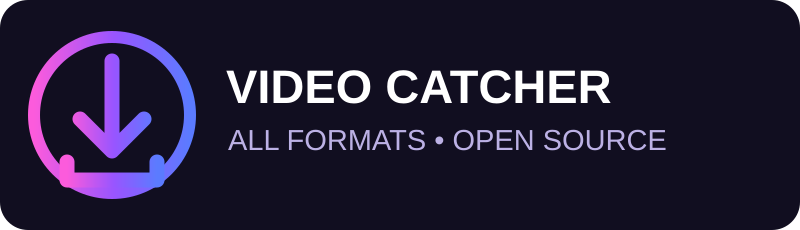

<div align="center">

# 🟣 Video Catcher All Formats
### Download media. Keep original quality.



[](#)
[](#)
[](LICENSE)
[](https://github.com/MoonDevil1/Video-Catcher-All-Formats/actions/workflows/package.yml)

<a href="https://github.com/MoonDevil1/Video-Catcher-All-Formats/raw/refs/heads/main/downloads/Video-Catcher-All-Formats-v2.2.0.zip"></a>

**[⬇️ Download Video Catcher All Formats — ZIP](https://github.com/MoonDevil1/Video-Catcher-All-Formats/raw/refs/heads/main/downloads/Video-Catcher-All-Formats-v2.2.0.zip)**

_Unzip the download, then install through Chrome → Extensions → Developer mode → Load unpacked._

**[Features](#-features) · [Install](#-installation) · [Limitations](#-current-limitations) · [Downloads](#-download-zip)**

</div>

---

## ✨ Features

| Feature | Description |
| --- | --- |
| 📡 Media detection | Detects video/audio URLs loaded in the active browser tab |
| ⬇️ Download Media | Downloads direct media files using Chrome's download manager |
| 🎛️ Quality selector | Displays quality variants **actually advertised** by supported HLS playlists |
| 🎵 Original audio | Direct files are downloaded unchanged, without audio re-encoding |
| 🧲 HLS detection | Recognizes `.m3u8` playlists and offers experimental unencrypted VOD downloads |
| 📋 Copy URL | Copies detected media links to clipboard |
| 🌙 Purple UI | Dark, responsive extension popup |
| ♾️ Free | No account, ads, subscription or extension-imposed daily quota |
| 🔐 Local by design | No server, analytics or telemetry |

## 🚀 Installation

1. Click the **DOWNLOAD ZIP FILE** button above to download the packaged extension (not the full source repository).
2. Extract the ZIP. Open `chrome://extensions` in desktop Chrome (or the equivalent page in Edge/Brave).
3. Enable **Developer mode**, click **Load unpacked**, and select the folder containing `manifest.json`.
4. Open a page with media, start playback, and click the extension icon.
5. Click **Download Media** on a direct file or **Choose Quality** on an HLS playlist.

> Standard Google Chrome on Android cannot load desktop Chrome extensions.

## 🖥️ Interface preview

```text
╭──────────────────────────────────╮
│ 🟣 VIDEO CATCHER   All Formats   │
│    Original media • No limits    │
├──────────────────────────────────┤
│ DETECTED MEDIA                   │
│                                  │
│ 🎬 clip.mp4               MP4    │
│ [ ⬇ Download Media ] [ Copy ]    │
│                                  │
│ 🎞 playlist.m3u8           HLS   │
│ [ 🎛 Choose Quality ] [ Copy ]   │
│                                  │
│            Clear List            │
╰──────────────────────────────────╯
```

## 🎛️ Quality, format and audio

Downloads of direct media preserve the file's **original video and audio streams**. No encoding or quality loss is introduced. The popup shows the source format. HLS quality choices come from the playlist's advertised variants; unavailable resolutions are not invented.

## ⚠️ Current limitations

- Some unencrypted *on-demand* HLS playlists can be downloaded in original segments, but not all stream configurations work. No live, encrypted, DRM-protected, byte-range or separate-audio merging.
- MPEG-DASH (`.mpd`) URLs are detected, but downloading DASH video/audio segments isn't implemented.
- There is **no universal format conversion**, no guaranteed MP4 output, and no way to synthesize higher quality than the source.
- Site authorization, CORS, formats and browser restrictions can prevent successful downloads. Very large HLS streams may exceed browser memory.
- YouTube downloads and DRM circumvention are not supported.
- Browser end-to-end testing and Chrome Web Store submission are **not yet complete**.

## 📦 Download ZIP

**[⬇️ Download the latest extension ZIP (v2.2.0)](https://github.com/MoonDevil1/Video-Catcher-All-Formats/raw/refs/heads/main/downloads/Video-Catcher-All-Formats-v2.2.0.zip)**. Extract it before using **Load unpacked**. GitHub Actions also produces build artifacts.

## 🛠️ Development

```bash
git clone https://github.com/MoonDevil1/Video-Catcher-All-Formats.git
cd Video-Catcher-All-Formats
node --check background.js
node --check content.js
node --check popup.js
node --check downloader.js
```

No npm runtime dependencies.

## 🔏 Privacy

Media URLs are processed inside your browser. The extension does not transmit your browsing or download data to our servers.

**Permissions:** `webRequest` to detect media requests; `downloads` to save chosen files; `tabs` to get the active tab; `storage` to hold detected results; broad site access for cross-site media detection.

Download only content you own or are authorized to save.

---

<div align="center">

Built with 💜 by [MoonDevil1](https://github.com/MoonDevil1) · ⭐ Star the project!

</div>